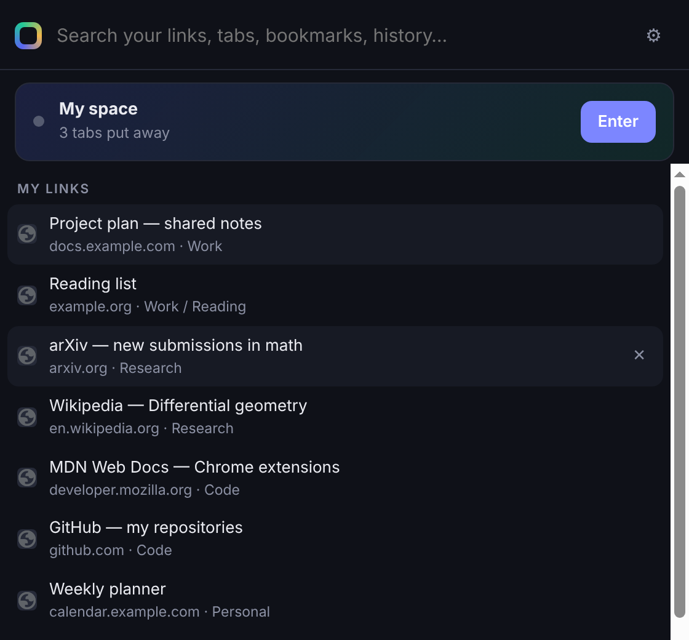
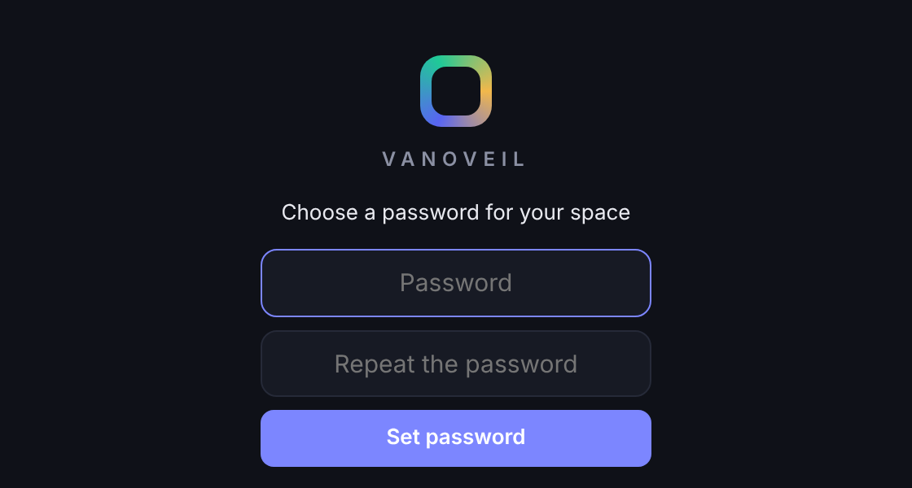
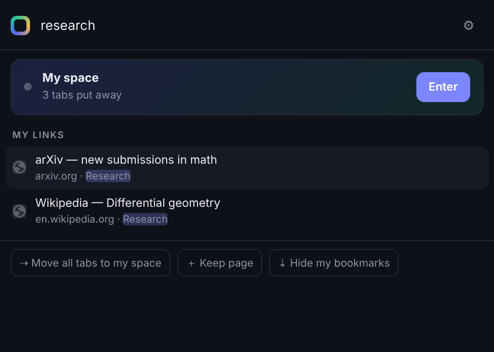
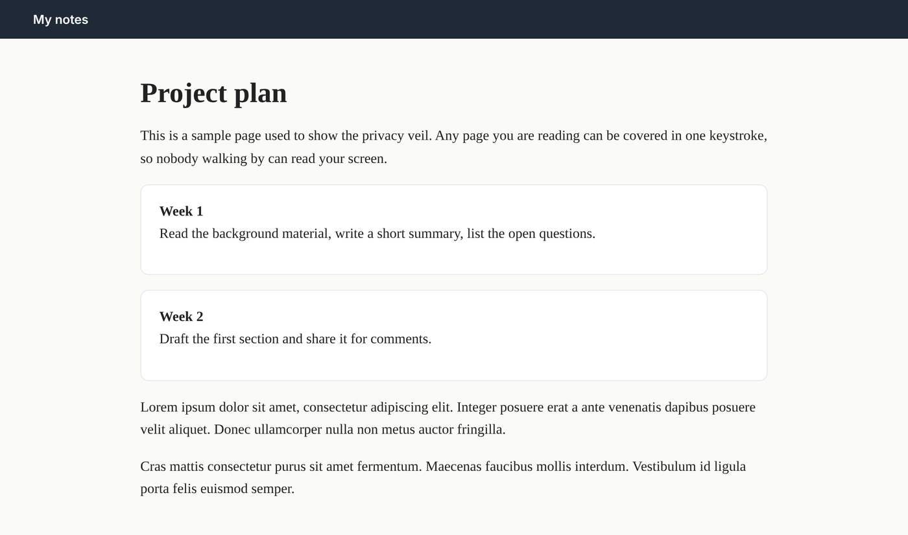
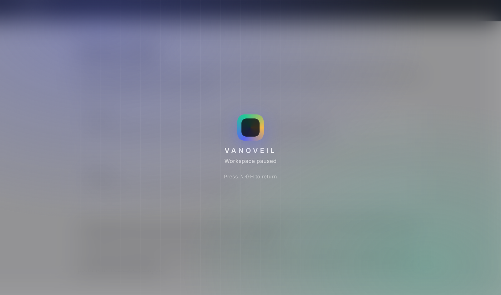
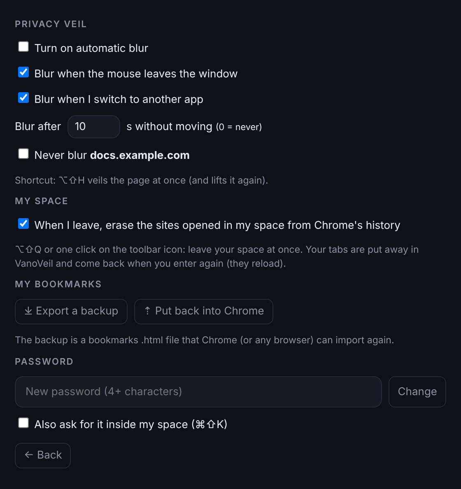

# VanoVeil

**Un coin privé dans Chrome.** VanoVeil te donne une barre de liens protégée par mot de passe, un espace de travail caché pour tes onglets et un voile de confidentialité qui couvre l'écran d'une seule touche. Gratuit, open source, et tout reste dans ton navigateur.

[English version](README.md)

<p align="center"></p>

> Toutes les captures utilisent des données d'exemple.

## Pourquoi VanoVeil ?

Tu partages un ordinateur, tu travailles en bibliothèque ou dans un open space, ou tu ne veux simplement pas que tous tes onglets et favoris soient visibles. Les profils Chrome et la navigation privée aident, mais c'est tout ou rien. VanoVeil fonctionne dans ton Chrome habituel :

- tes liens privés n'apparaissent pas dans la barre de favoris,
- les onglets de ton espace se rangent en un clic et reviennent quand tu veux,
- un raccourci couvre la page que tu lis.

## Fonctions

### 🔒 Une barre privée, protégée par mot de passe
**⌘⇧K** (Ctrl+Maj+K sous Windows et Linux) ouvre la barre. La première fois, tu choisis un mot de passe de 4 caractères ou plus.

<p align="center"></p>

- Le mot de passe n'est jamais enregistré tel quel : VanoVeil garde une empreinte PBKDF2-SHA-256 salée (210 000 itérations).
- Après 5 essais faux, la barre se bloque un moment, plus longtemps à chaque fois.
- Tu choisis si le mot de passe est redemandé à l'intérieur de ton espace.

### 🔎 Une seule recherche pour tout
Tape dans la barre pour chercher à la fois dans tes liens privés, tes onglets ouverts, tes favoris Chrome et ton historique. Utilise ↑ ↓ et ↵, ou clique. Les dossiers et les étiquettes comptent aussi.

<p align="center"></p>

- **＋ Keep page** garde la page courante dans tes liens privés.
- **⇣ Hide my bookmarks** déplace tes favoris Chrome dans la barre privée. Un fichier de sauvegarde est d'abord enregistré dans *Téléchargements/VanoVeil*, et rien n'est retiré tant que ce fichier n'est pas réellement sur le disque.

### 🪟 Mon espace, un espace de travail caché
**Enter** ouvre ton espace : une fenêtre Chrome à part, avec les onglets rangés la dernière fois.

- **Sortir** : **⌥⇧Q** (Alt+Maj+Q), ou un clic sur l'icône VanoVeil quand tu es dedans. La fenêtre se ferme tout de suite et ses onglets sont gardés pour la prochaine fois.
- **⇢ Move all tabs to my space** prend tous les onglets ouverts dans Chrome, les met dans ton espace et laisse Chrome vide.
- **Favoris privés** : les favoris créés dans ton espace n'apparaissent que dedans. Ils sont retirés de Chrome quand tu sors et reviennent quand tu rentres.
- En option, à la sortie, les sites ouverts dans ton espace sont effacés de l'historique de Chrome, des onglets récemment fermés et de la liste des téléchargements.

### 🌫️ Le voile de confidentialité
**⌥⇧H** (Alt+Maj+H) couvre n'importe quelle page d'un voile flou. Appuie encore pour le retirer.

<p align="center">
  
  &nbsp;
  
</p>

Le voile peut aussi venir tout seul (désactivé par défaut) : quand la souris sort de la fenêtre, quand tu passes à une autre app, ou après quelques secondes sans bouger. Tu peux exclure des sites.

### ⚙️ Réglages

<p align="center"></p>

- **⤓ Export a backup** enregistre tes liens privés dans un fichier de favoris `.html` standard, que tout navigateur sait importer.
- **⇡ Put back into Chrome** les remet dans les favoris de Chrome (*Autres favoris → Restored from VanoVeil*).

## Installation

VanoVeil n'est pas encore sur le Chrome Web Store. L'installation prend une minute :

1. Télécharge ce dépôt (**Code → Download ZIP**, ou le zip dans [Releases](../../releases)) et décompresse-le.
2. Ouvre `chrome://extensions` dans Chrome.
3. Active le **Mode développeur** (en haut à droite).
4. Clique sur **Charger l'extension non empaquetée** et choisis le dossier `extension`.
5. Épingle l'icône VanoVeil dans la barre d'outils, puis appuie sur **⌘⇧K**.

Les raccourcis se changent dans `chrome://extensions/shortcuts`.

Fonctionne dans Chrome, et devrait fonctionner dans les autres navigateurs Chromium (Edge, Brave, Arc).

> **Ne déplace pas le dossier.** Chrome lie une extension non empaquetée à son dossier. Si tu le déplaces ou le supprimes, ou si tu cliques sur **Supprimer** sur l'extension, Chrome la voit comme une nouvelle extension et tes liens, ton espace et ton mot de passe sont perdus. Exporte une sauvegarde avant.

## Raccourcis

| Raccourci | Action |
|---|---|
| ⌘⇧K / Ctrl+Maj+K | Ouvrir la barre privée |
| ⌥⇧Q / Alt+Maj+Q | Quitter mon espace tout de suite |
| ⌥⇧H / Alt+Maj+H | Voiler ou dévoiler la page |

## Confidentialité

- Pas de compte, pas de serveur, pas de statistiques. VanoVeil ne fait aucune requête réseau de lui-même : tout est gardé dans `chrome.storage.local`, sur ton ordinateur.
- Les icônes des sites viennent du cache d'icônes de Chrome : aucun site ni service n'est contacté pour les afficher.

## Limites, en toute honnêteté

VanoVeil est un outil de **discrétion**, pas un coffre-fort.

- Le mot de passe protège l'interface de VanoVeil. Tes liens sont enregistrés sans chiffrement dans le stockage des extensions de Chrome : quelqu'un qui a un accès complet à ta session et quelques connaissances techniques pourrait encore les lire.
- L'effacement porte sur l'historique de Chrome. Il ne change rien pour ton réseau, ton employeur, ton fournisseur DNS ou les sites visités.
- Pour un vrai secret, utilise une session d'ordinateur séparée avec son propre mot de passe, et le chiffrement du disque.

## Structure du projet

```
extension/
  manifest.json    manifeste Chrome MV3, permissions et raccourcis
  background.js    service worker : mon espace, favoris privés, nettoyage de l'historique
  bar.html/css/js  la barre privée, l'écran du mot de passe et les réglages
  veil.js          le voile, injecté dans chaque page
  icons/
docs/              captures d'écran
```

Permissions : `storage`, `favicon`, `tabs`, `bookmarks`, `history`, `downloads` (fichier de sauvegarde et nettoyage de la liste des téléchargements), et accès à tous les sites pour le voile.

## Licence

MIT © Yassine Ait Mohamed
